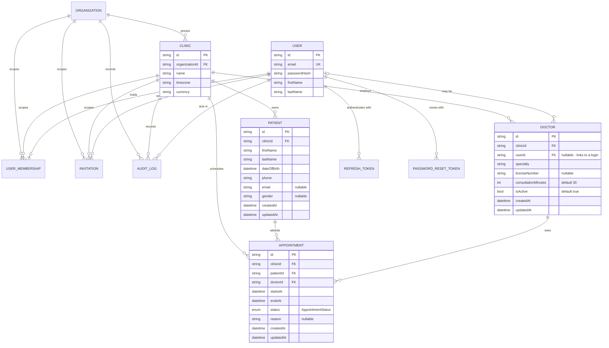

# Entity Relationship Diagram

Clinical core introduced by **BP-002** (`database-schema-and-migrations`), plus the tenancy
tables it depends on. The canonical definition is [`schema.prisma`](./schema.prisma); this
document explains the shape and the relationships, and is kept in step with it.

## Diagram

## Entities

| Entity        | Table          | Purpose                                                                        |
| ------------- | -------------- | ------------------------------------------------------------------------------ |
| `Patient`     | `patients`     | A person receiving care at one clinic. Carries no credentials in this version. |
| `Doctor`      | `doctors`      | A clinician's profile **at one clinic**, optionally linked to a global login.  |
| `Appointment` | `appointments` | One booked visit joining a patient and a doctor inside a single clinic.        |

`AppointmentStatus` is a Postgres enum with `SCHEDULED`, `CONFIRMED`, `CHECKED_IN`,
`IN_PROGRESS`, `COMPLETED`, `CANCELLED` and `NO_SHOW`. BP-002 defines the values only; the
legal transitions belong to BP-019.

## Relationships and delete rules

| From          | To        | Cardinality           | On delete  | Why                                                           |
| ------------- | --------- | --------------------- | ---------- | ------------------------------------------------------------- |
| `Patient`     | `Clinic`  | many-to-one           | `RESTRICT` | A clinic holding patients must not vanish silently (EC-005).  |
| `Doctor`      | `Clinic`  | many-to-one           | `RESTRICT` | Same reasoning as patients.                                   |
| `Doctor`      | `User`    | many-to-one, optional | `SET NULL` | Deleting the login keeps the clinical record intact (EC-004). |
| `Appointment` | `Clinic`  | many-to-one           | `RESTRICT` | Tenant boundary must survive.                                 |
| `Appointment` | `Patient` | many-to-one           | `CASCADE`  | A visit cannot exist without its patient.                     |
| `Appointment` | `Doctor`  | many-to-one           | `RESTRICT` | A doctor with history must not be deleted outright.           |

## Tenant scoping

`patients`, `doctors` and `appointments` each carry `clinicId` with a foreign key to `clinics`.
Tenant isolation is therefore a schema guarantee rather than an application convention
(NFR-004, CON-516): a query that omits `clinicId` returns rows from every clinic only if it
asks for them, and there is no path that silently mixes clinics.

## Indexes

| Table          | Index                  | Serves                                                   |
| -------------- | ---------------------- | -------------------------------------------------------- |
| `appointments` | `(doctorId, startsAt)` | A doctor's day, ordered by time (BP-015, BP-019).        |
| `appointments` | `(patientId)`          | A patient's appointment history (BP-015).                |
| `patients`     | `(clinicId, lastName)` | The patient directory's list and search within a clinic. |
| `doctors`      | `(clinicId, isActive)` | The active-clinician list for booking (BP-018).          |

## Known gap

`endsAt > startsAt` cannot be expressed in the Prisma schema, so nothing at the database level
prevents an appointment that ends before it starts. EC-003 records this and assigns enforcement
to BP-019's booking rules.
